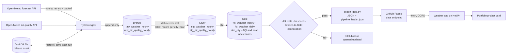

# PH Weather & Air Quality Pipeline

A small but complete, **live** data engineering project: every hour it ingests weather and
air-quality data for six Philippine cities, models it with dbt into Bronze / Silver / Gold
layers, tests it, and publishes the Gold layer as JSON that powers a weather app.

- **Live app:** https://ph-weather-pipeline.netlify.app/
- **Hourly data endpoint (GitHub Pages):** https://dtopgoat.github.io/ph-weather-pipeline/
- **Stack:** Python · DuckDB · dbt (dbt-duckdb) · sqlfluff · pytest · GitHub Actions · Plotly
- **Running cost:** PHP 0 (free Open-Meteo APIs, GitHub Actions on a public repo, GitHub Pages, Netlify free plan)

Cities: Baguio, Quezon City (Metro Manila), Cebu City, Iloilo City, Cagayan de Oro and Davao City.

## Architecture



All of this runs in one GitHub Actions workflow (`.github/workflows/pipeline.yml`) at 17 minutes
past every hour.

## How it works

| Step | What happens | Code |
|---|---|---|
| Ingest | For each city, request hourly temperature, apparent temperature, humidity, precipitation, wind and weather code (recent past hours + 7-day forecast) and hourly PM2.5, PM10 and US AQI. Retries on network errors, HTTP 429 and 5xx with exponential backoff; all cities are fetched before anything is written, so a failed call never leaves a half-written run. Rows are appended to Bronze with a `run_id` and a UTC `loaded_at`. | `ingest/fetch.py` |
| Transform | dbt builds Silver and Gold inside the same DuckDB file. | `models/` |
| Test | 39 dbt tests plus source freshness. Results are saved to `ops.dq_results` and `dq_results.json`. | `models/**.yml`, `data_tests/` |
| Export | Gold is written to small static JSON files (about 170 KB in total) plus `pipeline_health.json`. | `scripts/export_gold.py` |
| Publish | The JSON is deployed to GitHub Pages; the app fetches it from there. | `pipeline.yml` |

### Bronze / Silver / Gold

- **Bronze (`bronze` schema), raw and append-only.** Exactly what the API returned, one row per
  city × hour × load. Each hourly run re-sends the last day and the next 7 days, so the same hour
  shows up many times as forecasts are revised. `bronze.ingest_runs` is the run audit log.
- **Silver (`silver` schema), typed and deduplicated.** `stg_weather_hourly` and
  `stg_air_quality_hourly` are **incremental** models with a composite unique key
  `(city_id, observed_at_local)` and `delete+insert`. Each run reads only Bronze rows loaded since the
  newest Silver load **minus a lookback window** (`lookback_hours`, default 3), ranks them with
  `row_number()` per key by `loaded_at desc`, and keeps the latest record. The lookback means a
  late or re-run load is never skipped, and `delete+insert` on the key makes reprocessing idempotent.
  This is the same "latest record per key" pattern that fixed a ~97% duplication bug in a production
  pipeline I worked on.
- **Gold (`gold` schema), ready for the app.**
  - `dim_city`: the six cities (from a seed).
  - `fct_weather_hourly`: weather joined to air quality per city and hour, with `is_forecast`,
    a heat index (NOAA Rothfusz formula), the PAGASA heat-index band and the US EPA AQI band.
  - `fct_weather_daily`: daily rollup per Manila calendar day (min/max/avg temperature, rain total,
    max wind, peak heat index and AQI with their bands).
  - Reference seeds: `aqi_bands`, `heat_index_bands`, `weather_codes` (`ref` schema).

### Data quality checks

- **Keys:** unique `(city_id, observed_at_local)` in both Silver models and the hourly fact;
  unique `(city_id, observed_date_local)` in the daily rollup; unique/not-null `dim_city.city_id`.
- **Not null / relationships:** run ids, timestamps and city ids in Bronze; every city in Bronze
  and Gold exists in `dim_city`; every weather code exists in the WMO code seed.
- **Accepted values:** heat-index categories, AQI categories, island groups.
- **Ranges:** temperature −5 to 50 °C, humidity 0–100 %, precipitation 0–300 mm/h, wind 0–400 km/h,
  PM2.5 0–1000, PM10 0–2000, US AQI 0–500, heat index −10 to 70 °C, 1–24 hours per day.
- **Source freshness:** Bronze warns after 2 hours and errors after 6 hours without a load.
- **Reconciliation:** `data_tests/assert_bronze_to_gold_reconciles.sql` checks that every distinct
  city × hour key in Bronze appears exactly once in Silver, and that Gold has exactly as many rows as
  Silver.

The health panel in the app shows the last run time (UTC and Manila), rows loaded, test pass/fail
counts, freshness, row counts per layer and the last 48 runs.

## Storage choice: DuckDB file as a release asset

The warehouse is a single DuckDB file. Between runs it is gzipped and stored as an asset on a
GitHub release called `warehouse-state`, overwritten every hour (`gh release upload --clobber`), then
downloaded at the start of the next run.

Why this instead of committing data to git:

- **No repo growth.** Hourly data commits would add roughly 8,700 commits a year and steadily grow
  the repository. A release asset is replaced in place, so the repo stays small.
- **Bounded file size.** Bronze keeps 14 days of raw loads (`--retention-days`); older raw loads are
  deleted at ingest because Silver already holds the deduplicated history. Silver and Gold grow by
  only about 52,000 rows per city-year in total, and DQ history is trimmed to 30 days.
- **No bot commits.** The hourly job never pushes to the repo, so the git history contains only
  human commits.

The trade-off: if the asset is lost, the pipeline starts fresh with a 7-day backfill (Open-Meteo can
backfill up to 92 days; see the runbook).

## Hosting: why the app is on Netlify and the data is on GitHub Pages

The app (HTML/CSS/JS + vendored Plotly) is deployed to Netlify **manually and rarely**, only when the
front end changes. The hourly job publishes data only to GitHub Pages, which serves files with
`Access-Control-Allow-Origin: *`. Netlify's free plan has a monthly deploy budget, so hourly Netlify
deploys would exhaust it within a day; this split avoids that entirely. The Netlify site is not linked
to this repository, so no push triggers a Netlify build. The app's CSP allows `connect-src` only to
`'self'` and `https://dtopgoat.github.io`.

To redeploy the app after a front-end change: `netlify deploy --prod --dir app --site <site-id>`.

## Running locally

```bash
python -m venv .venv && source .venv/bin/activate
pip install -r requirements-dev.txt
export DUCKDB_PATH=warehouse/weather.duckdb DBT_PROFILES_DIR=.
mkdir -p warehouse
python -m ingest.fetch --past-days 7      # Bronze
dbt build                                 # Silver + Gold + tests
dbt source freshness
python -m scripts.export_gold             # JSON in build/site/data
ln -s ../build/site/data app/data && python -m http.server -d app 8000   # app reads ./data on localhost
pytest -q && sqlfluff lint models data_tests
```

## Runbook

- **Rerun now:** Actions → *Hourly pipeline* → *Run workflow* (or `gh workflow run pipeline.yml`).
- **Backfill:** run the workflow with `past_days` up to `92`. Bronze gets the extra history and the
  incremental Silver models pick it up because it is newly loaded. For a clean rebuild of Silver, also
  tick `full_refresh` (note that only Bronze's retained 14-day window plus the backfilled days survive).
- **When a run fails:** the `report` job opens an issue labelled `pipeline-failure` (or comments on
  the open one) with the run link. The app keeps serving the last successful data and its health panel
  turns "Stale" after about 2.5 hours. When a later run succeeds, the issue is closed automatically.
  Common causes: an Open-Meteo outage (ingest retries 3 times with backoff and the next hourly run
  usually recovers), a failing range test after an upstream data change (inspect the test in the run
  log; `dq_results.json` lists every check), or a GitHub Pages deploy hiccup (rerun).
- **Lost warehouse asset:** nothing to do; the next run starts fresh with a 7-day backfill. Run a
  `past_days: 92` backfill to restore more history.
- **Schedule disabled:** GitHub disables scheduled workflows in public repos after **60 days with no
  repository activity**. Because the hourly job deliberately makes no commits, it does not count as
  activity. The workflow re-enables itself through the API once a week as a best-effort keepalive; if
  GitHub still disables it, re-enable it from the Actions tab or push any commit.

## Limits and attribution

- Hourly values come from Open-Meteo's weather and air-quality models. They are not official PAGASA or
  DENR-EMB station observations, and "past" hours are model analysis rather than measured readings.
- Weather and air-quality data by [Open-Meteo.com](https://open-meteo.com/), licensed CC BY 4.0. Free
  for non-commercial use, which this portfolio project is.
- GitHub's scheduler can start runs several minutes late at busy times.

## Roadmap

- **Snowflake edition (coming):** the same pipeline on Snowflake, using streams, tasks and `MERGE`
  for the Silver dedup, to show the production version of this design.
- Forecast-versus-actual accuracy mart, published dbt docs site, and a Slack/email alert channel.
